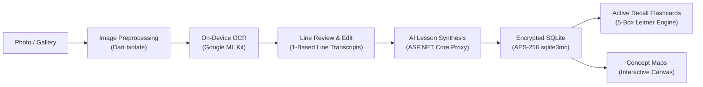

# NeuroScript AI

[](https://github.com/zaintahir2025/neuroscript-ai/actions/workflows/ci.yml)
[](https://flutter.dev)
[](https://dart.dev)
[](https://dotnet.microsoft.com)
[](docs/TESTING.md)
[](LICENSE)

NeuroScript AI is an offline-first, privacy-preserving study application engineered for university students with ADHD, Dyslexia, and Autism Spectrum conditions. University lecture notes often cause cognitive overload, scotopic visual fatigue, and executive dysfunction. NeuroScript AI addresses this by transforming photos of handwritten or printed notes into structured, accessible study units—featuring 1-based line provenance, active-recall flashcards scheduled via a 5-box Leitner spaced repetition engine, 2D interactive concept maps, and three dedicated accessibility profiles adhering to WCAG 2.1 AA standards.

---

## What Works Today vs What is Planned

| Capability | Milestone | Status | Technical Details |
| :--- | :--- | :--- | :--- |
| **Note Ingestion & Camera** | M1–M3 | **Implemented** | Camera viewfinder with framing guide, gallery image import (1–5 pages). |
| **Image Preprocessing** | M1–M3 | **Implemented** | Pure-Dart `image` package in background isolate (grayscale, contrast, smoothing, deskew). |
| **On-Device OCR & Review** | M1–M3 | **Implemented** | Google ML Kit Text Recognition with 1-based line numbering (`L1`, `L2`, ...) & full editor. |
| **Encrypted Database** | M1–M3 | **Implemented** | Drift ORM on SQLite with `sqlite3mc` (SQLCipher AES-256 mode), key in `FlutterSecureStorage`. |
| **Spaced Repetition & Maps** | M1–M3 | **Implemented** | Deterministic 5-box Leitner scheduler, interactive canvas concept map with pinch-to-zoom. |
| **Backend AI Proxy** | M1–M3 | **Implemented** | ASP.NET Core (.NET 10 LTS) rate-limiting proxy with constant-time API key verification. |
| **Gemini Lesson Generator** | M4A | **Implemented** | Server-side structured lesson generation calling Google Gemini API with fallback handling. |
| **Grounding Verification** | M4B | **Planned** | Deterministic line-citation verification engine against source transcript (`docs/ROADMAP.md`). |
| **On-Device SLM (Offline)** | M4C | **Planned** | Local GGUF small language model execution via `llamadart` (`docs/TECH_STACK.md`). |
| **Semantic Embedding** | M5 | **Planned** | Vector clustering for related notes via `all-MiniLM-L6-v2` (`docs/TECH_STACK.md`). |
| **Text-to-Speech (TTS)** | M6 | **Planned** | Dyslexia auditory narration via `flutter_tts` (`docs/TECH_STACK.md`). |

---

## App Interface Preview

| ADHD Profile (Focus) | Dyslexia Profile (Soft Cream) | Autism Profile (Calm Teal) |
| :---: | :---: | :---: |
|  |  |  |
| *5-card micro-sessions, minimal clutter* | *Anti-glare background, high readability* | *Predictable structure, low sensory noise* |

| Concept Map Navigation | Flashcard Active Recall | Accessibility Settings |
| :---: | :---: | :---: |
|  |  |  |
| *Visual relationship graph with zoom* | *Dual study paths with source line citations* | *Profile selection, scale & motion toggles* |

---

## How It Works



---

## Tech Stack Summary

| Layer | Component | Version | Role & Notes |
| :--- | :--- | :--- | :--- |
| **Mobile App** | Flutter SDK | `>=3.47.5` | Cross-platform mobile client (Android API 24+, iOS 14+). |
| **Language** | Dart SDK | `^3.13.4` | Sound null-safe client application logic. |
| **State & Router** | Riverpod / GoRouter | `3.5.0` / `18.1.4` | Reactive unidirectional data flow and declarative routing. |
| **Database** | Drift / sqlite3mc | `2.35.4` / `3.9.1` | Encrypted local persistence (`PRAGMA cipher = 'sqlcipher'`). |
| **Hardware Keystore** | flutter_secure_storage | `11.2.0` | 256-bit AES master key stored in Android KeyStore / iOS Keychain. |
| **OCR Engine** | ML Kit Text Recognition | `1.0.3` | Sole optical character recognition engine (on-device CNN). |
| **Image Pipeline** | Pure-Dart `image` | `4.13.1` | Bounded resize, grayscale, dynamic contrast, spatial smoothing, deskew. |
| **Backend Gateway** | ASP.NET Core | `.NET 10 LTS` | Rate-limiting proxy gateway (`server/NeuroScriptProxy/`). |
| **AI Synthesis** | Google Gemini API | Configurable | Structured lesson compilation called solely via the backend proxy. |

*For complete details, package dependencies, and future packages, see [docs/TECH_STACK.md](docs/TECH_STACK.md).*

---

## Getting Started

### Prerequisites

* Flutter SDK `>=3.47.5` and Dart SDK `^3.13.4`
* Android SDK (API 24+) or iOS toolchain (Xcode 15+)
* .NET 10.0 SDK (for running the backend proxy)

### 1. Run the Mobile App

```bash
# Clone the repository
git clone https://github.com/zaintahir2025/neuroscript-ai.git
cd neuroscript-ai

# Install dependencies and build generated code
flutter pub get
dart run build_runner build --delete-conflicting-outputs

# Launch the app on a connected Android/iOS device or emulator
flutter run
```

### 2. Run the Backend Proxy Server

```bash
# Navigate to proxy project
cd server/NeuroScriptProxy

# Set your Gemini API key (required in production)
export GEMINI_API_KEY="your-gemini-api-key-here"

# Run the ASP.NET Core service
dotnet run
```

The proxy starts listening on `http://localhost:5000` (or `https://localhost:5001`). Verify health at `http://localhost:5000/health`.

### 3. Run Automated Tests

```bash
# Run all 110 Flutter unit, widget, and contract tests
flutter test

# Run C# backend proxy tests
dotnet test server/NeuroScriptProxy/NeuroScriptProxy.sln
```

---

## Project Roadmap (Milestones M1–M6)

| Milestone | Target | Description | Status | Reference |
| :--- | :--- | :--- | :--- | :--- |
| **M1** | Month 1 | Architecture, Requirements, Contracts & Seed Units | **Completed** | [docs/ROADMAP.md](docs/ROADMAP.md#m1-foundations--core-data-contracts) |
| **M2** | Month 2 | Encrypted Database (sqlite3mc) & Spaced Repetition | **Completed** | [docs/ROADMAP.md](docs/ROADMAP.md#m2-encrypted-persistence--spaced-repetition) |
| **M3** | Month 3 | Optical Capture, Isolate Preprocessing & OCR Editor | **Completed** | [docs/ROADMAP.md](docs/ROADMAP.md#m3-optical-capture-preprocessing--transcription-editor) |
| **M4** | Month 4 | Hybrid AI Generation (Proxy Gemini + Local SLM fallback) | **In Progress (M4A Done)** | [docs/ROADMAP.md](docs/ROADMAP.md#m4-hybrid-ai-synthesis--grounding-verification) |
| **M5** | Month 5 | Semantic Note Clustering & Vector Embeddings | **Planned** | [docs/ROADMAP.md](docs/ROADMAP.md#m5-semantic-embeddings--cross-note-synthesis) |
| **M6** | Month 6 | Assistive Audio (TTS) & Clinical Psychologist Evaluation | **Planned** | [docs/ROADMAP.md](docs/ROADMAP.md#m6-assistive-audio-tts--evaluation) |

---

## Privacy & Security Summary

* **Local-First Encrypted Storage:** All student notes, transcripts, lessons, and flashcards are encrypted on disk with AES-256 via `sqlite3mc` in SQLCipher-compatible mode. Verified in `test/encryption_verification_test.dart`.
* **Hardware-Backed Keystore:** The 256-bit database key is stored in Android KeyStore / iOS Keychain via `flutter_secure_storage`.
* **Zero Note Persistence on Server:** The ASP.NET Core proxy is stateless regarding user notes. It logs only anonymous operational metadata (install ID hash, line count, status code, latency) to enforce rate limits.
* **Controlled Cloud Transmission:** Note lines leave the device only when the user explicitly requests lesson generation. Upstream Google Gemini API calls are made exclusively through the proxy; API keys are never embedded in the mobile binary.

*For comprehensive architecture and threat analysis, see [docs/PRIVACY_AND_SECURITY.md](docs/PRIVACY_AND_SECURITY.md).*

---

## Accessibility Design Summary

NeuroScript AI provides three evidence-informed profiles created from neurodiversity accessibility literature:

1. **ADHD:** High-contrast focus palette (`#3F51B5`), dopamine feedback animations, strict 5-card micro-session limits to mitigate executive dysfunction and fatigue.
2. **Dyslexia:** Anti-glare warm cream canvas (`#FBF8EE`), relaxed line spacing (1.6), increased letter tracking (+0.6), high-contrast text (`#2B2D42`).
3. **Autism:** Calm low-arousal palette (`#3D6B7A`, `#EEF3F4`), predictable linear navigation, reduced motion toggle to eliminate unexpected sensory visual transitions.

*Compliance Note:* All theme color combinations pass WCAG 2.1 AA contrast requirements ($\ge 4.5:1$), verified in `test/theme_wcag_test.dart`. The UI supports up to $2.0\times$ system text scaling without overflow, verified in `test/golden_test.dart`. Formal clinical evaluation with professional educational psychologists is in progress ([docs/EXPERT_REVIEW.md](docs/EXPERT_REVIEW.md)).

---

## Known Limitations

1. **Hardware OCR Benchmarks:** Automated tests execute in CI and emulators, but physical hardware execution benchmarks across consumer device matrices are **NOT MEASURED YET** ([docs/DEVICE_VERIFICATION_MATRIX.md](docs/DEVICE_VERIFICATION_MATRIX.md)).
2. **On-Device SLM:** Local offline generation (M4C) is planned for Month 4; the current release requires network connectivity to the proxy for generating new lessons from raw notes.
3. **Clinical Validation:** Profiles follow published accessibility design principles, but formal psychological efficacy trials are **NOT COMPLETED YET**.

---

## Team & Academic Metadata

* **Institution:** Department of Computer Science, University of Engineering & Technology (UET) Taxila
* **Course:** CS-400 Final Year Project (Academic Year 2026–2027)
* **Supervisor:** Mr. Awais Mehmood
* **Authors:**
  * **Zain Tahir** (23-CS-115) – Architecture, Database, Mobile Client & Backend Proxy
  * **Ujala Sahar** (23-CS-135) – UI/UX Design System, Accessibility & Testing

---

## Documentation Quick Links

* [Documentation Index](docs/README.md)
* [System Architecture](docs/ARCHITECTURE.md)
* [Database Schema & ER Model](docs/DATA_MODEL.md)
* [Proxy API Specification](docs/API.md)
* [Privacy & Security Architecture](docs/PRIVACY_AND_SECURITY.md)
* [Accessibility Design Specification](docs/ACCESSIBILITY_DESIGN.md)
* [Student User Guide](docs/USER_GUIDE.md)
* [Developer Setup & Contributing](docs/DEVELOPMENT.md)
* [Testing Guide & Metrics](docs/TESTING.md)
* [Project Roadmap M1–M6](docs/ROADMAP.md)
* [Evaluation & Traceability Matrix](docs/EVALUATION.md)
* [Expert Review Protocol](docs/EXPERT_REVIEW.md)
* [Glossary](docs/GLOSSARY.md) & [FAQ](docs/FAQ.md)
* [Manual / Hardware Action Items](docs/MANUAL_TODO.md)

---

## License

This project is licensed under the MIT License - see the [LICENSE](LICENSE) file for details.
