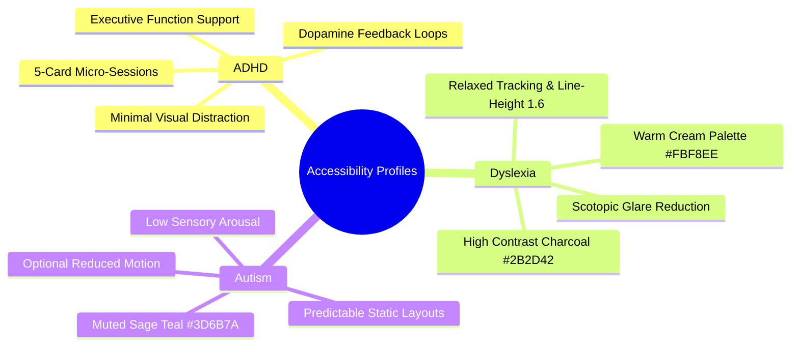

# Neurodivergent Accessibility Design Architecture

This document outlines the cognitive design rationale, sensory accommodation choices, visual tokens, and empirical verification procedures governing the three learner profiles in NeuroScript AI.

---

## 1. Compliance & Medical Disclaimer

> [!IMPORTANT]
> **Published Accessibility Guidance vs. Clinical Trials:**
> The design patterns implemented in NeuroScript AI are synthesized from established human-computer interaction (HCI) literature, W3C Web Content Accessibility Guidelines (WCAG 2.1 AA), and the British Dyslexia Association Style Guide. They are **NOT** medical treatments or diagnostic tools. Formal clinical efficacy trials and expert psychological reviews are currently pending ([docs/EXPERT_REVIEW.md](EXPERT_REVIEW.md)).

---

## 2. Learner Profiles Rationale

### 2.1 ADHD Profile (Attention-Deficit / Hyperactivity Disorder)

* **Cognitive Need:** Learners with ADHD frequently experience working memory overload, distractibility, and executive dysfunction when confronted with dense blocks of text.
* **Design Implementations:**
  * **Strict Micro-Session Cap:** Flashcard review sessions are hard-capped at **5 cards per set** by default. Completing small batches prevents burnout and provides rapid dopamine completion cues.
  * **Color Palette:** High-energy Deep Indigo (`#3F51B5`) primary with Warm Amber (`#FF9800`) secondary on an ultra-clean neutral background (`#F8F9FA`).
  * **Visual Clutter Suppression:** Secondary metadata and decorative icons are hidden during study review, maximizing focus on the central question.
* **Code Implementation:** `AppPalettes.adhdPrimary`, `AppPalettes.adhdBackground` in `lib/core/theme/app_palettes.dart`.

---

### 2.2 Dyslexia Profile

* **Cognitive Need:** Learners with dyslexia often suffer from visual crowding, scotopic sensitivity (Meares-Irlen syndrome), and glare induced by high-contrast pure white (`#FFFFFF`) backgrounds.
* **Design Implementations:**
  * **Anti-Glare Canvas:** Background uses a soft, warm cream tone (`#FBF8EE`) to reduce visual stress and ocular fatigue.
  * **Typographic Spacing:** Text styles employ relaxed line-height ($1.6\times$) and increased letter tracking ($+0.6$) to eliminate letter collision and overcrowding.
  * **High-Readability Typography:** Sans-serif typography with distinct character shapes and dark charcoal text (`#2B2D42`), preventing the harsh contrast vibration of pure black on white.
* **Code Implementation:** `AppPalettes.dyslexiaPrimary` (`#1E3A8A`), `AppPalettes.dyslexiaBackground` (`#FBF8EE`) in `lib/core/theme/app_palettes.dart`.

---

### 2.3 Autism Profile (Autism Spectrum Conditions)

* **Cognitive Need:** Learners on the autism spectrum frequently experience sensory hyper-reactivity to bright saturated colors, unexpected visual transitions, and inconsistent UI structures.
* **Design Implementations:**
  * **Sensory Soothing Palette:** Uses calming Muted Sage Teal (`#3D6B7A`) and soft Ice Mist slate (`#EEF3F4`) to minimize sensory arousal.
  * **Predictable Structural Hierarchy:** Rigid, predictable layout geometry with uniform card containers and linear progress indicators.
  * **Reduced Motion Toggle:** Disables 3D card flips and spring animations, replacing them with instantaneous, low-friction state toggles.
* **Code Implementation:** `AppPalettes.autismPrimary` (`#3D6B7A`), `AppPalettes.autismBackground` (`#EEF3F4`) in `lib/core/theme/app_palettes.dart`.

---

## 3. Visual Token Matrix

| Design Dimension | ADHD Profile | Dyslexia Profile | Autism Profile |
| :--- | :--- | :--- | :--- |
| **Primary Theme Color** | Deep Indigo (`#3F51B5`) | Slate Blue (`#1E3A8A`) | Muted Sage Teal (`#3D6B7A`) |
| **Secondary Accent** | Warm Amber (`#FF9800`) | Warm Amber (`#FF9800`) | Ice Mist Slate (`#607D8B`) |
| **Canvas Background** | Neutral Gray (`#F8F9FA`) | Warm Anti-Glare Cream (`#FBF8EE`) | Uniform Ice Mist (`#EEF3F4`) |
| **Surface Card Fill** | Pure White (`#FFFFFF`) | Soft Tinted Cream (`#F7F4E9`) | Pristine Soft White (`#FFFFFF`) |
| **Body Typography** | Dark Charcoal (`#1F2937`) | Soft Charcoal (`#2B2D42`) | Deep Slate (`#1A2E35`) |
| **Line Height / Spacing** | Standard ($1.4\times$) | Relaxed ($1.6\times$, tracking $+0.6$) | Structured ($1.5\times$, tracking $+0.2$) |
| **Session Batch Size** | **5 cards** (strict cap) | 10 cards | 10 cards |
| **Minimum Touch Target** | $\ge 48 \times 48\text{ dp}$ | $\ge 48 \times 48\text{ dp}$ | $\ge 48 \times 48\text{ dp}$ |

---

## 4. Empirical Verification & Automated Tests

All accessibility claims are backed by automated tests running in CI:

### 4.1 Contrast Ratio Verification (`test/theme_wcag_test.dart`)

Every color combination is tested against the W3C Relative Luminance formula $\frac{L_1 + 0.05}{L_2 + 0.05}$:

* **Body Text Threshold:** Requires contrast ratio $\ge 4.5:1$ against surface and background.
  * ADHD text on background: $> 12:1$ (Passed)
  * Dyslexia text on warm cream: $> 11:1$ (Passed)
  * Autism text on soft teal: $> 10:1$ (Passed)
* **UI Controls & Large Text:** Requires contrast ratio $\ge 3.0:1$ (Passed across all profiles).

### 4.2 Text Scaling Golden & Overflow Tests (`test/golden_test.dart`)

* Asserts that all core application screens (Library, Capture, OCR Review, Flashcard Review, Concept Map, Settings) render cleanly at $1.0\times$ and $2.0\times$ system text scaling without any `RenderFlex` overflow errors.

---

## 5. Ongoing Expert Psychologist Review

A formal psychologist evaluation instrument has been drafted and is located in the repository at:

* [`docs/evaluation/NeuroScript_AI_Psychologist_Evaluation_Form.docx`](evaluation/NeuroScript_AI_Psychologist_Evaluation_Form.docx)
* [`docs/evaluation/NeuroScript_AI_Psychologist_Review_Form_Final.docx`](evaluation/NeuroScript_AI_Psychologist_Review_Form_Final.docx)

For protocol details and post-review modification logging, see [docs/EXPERT_REVIEW.md](EXPERT_REVIEW.md).
