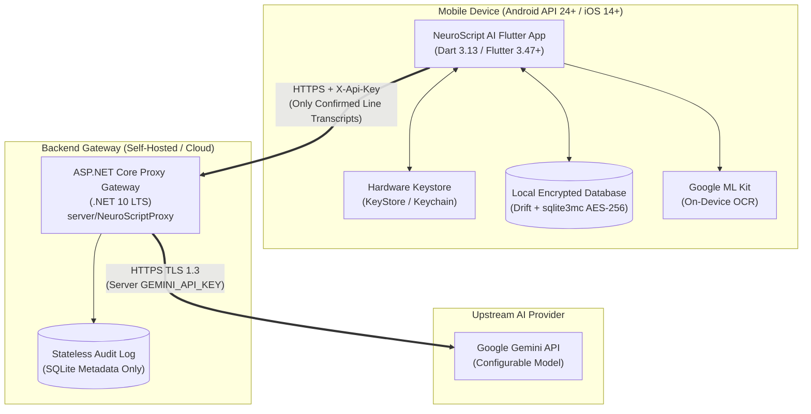
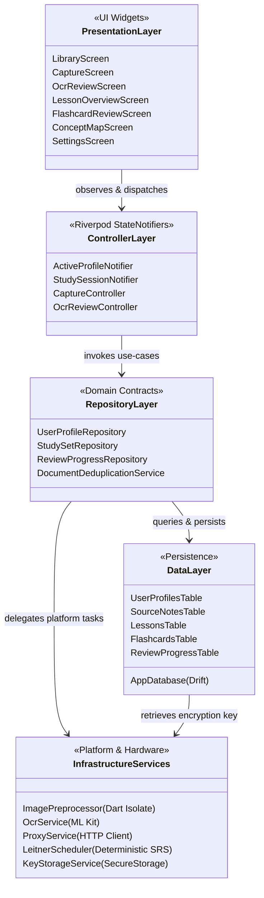
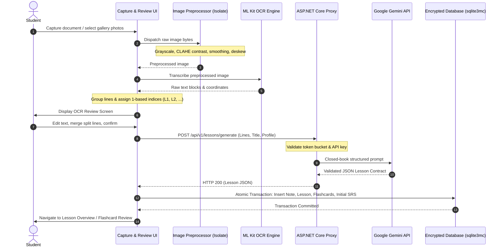
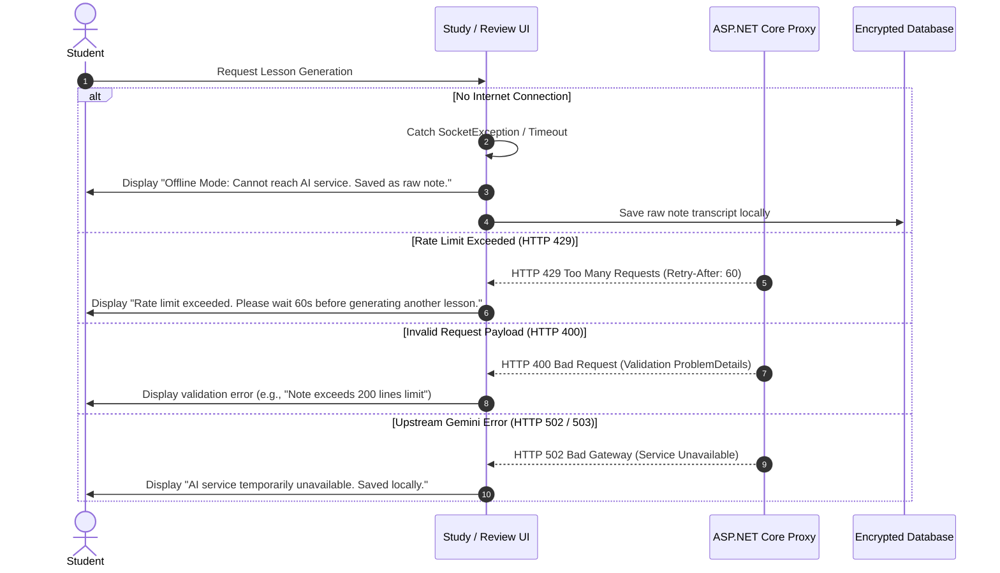

# System Architecture & Component Design

This document describes the architectural topology, data boundaries, state management lifecycles, and component interactions of NeuroScript AI.

---

## 1. System Context Diagram

NeuroScript AI employs an offline-first, hybrid cloud architecture. The Flutter client manages all user interactions, local encryption, optical character recognition, and spaced repetition scheduling on the student's mobile device. The cloud proxy acts as an ephemeral, rate-limiting boundary to upstream language models.



---

## 2. Component Architecture

The mobile application follows a layered architectural pattern (Presentation, Controller, Domain/Repository, Data/Persistence, and Infrastructure Services):



---

## 3. Sequence Diagrams

### 3.1 Standard Note Capture to Study Unit Generation



### 3.2 Error & Offline Failure Path (Current Implementation)



---

## 4. State Management Flow (Riverpod)

NeuroScript AI uses Riverpod (`3.5.0`) for compile-safe, testable state management without global singletons.

1. **Unidirectional Data Flow:**
   * **State Providers / Notifiers:** Hold immutable state objects (e.g., `AsyncValue<List<LessonWithCards>>`).
   * **UI Consumers:** Use `ref.watch(provider)` to rebuild strictly when observed state changes.
   * **Intent Dispatch:** UI widgets invoke controller methods (e.g., `ref.read(studySessionControllerProvider.notifier).recordAnswer(cardId, isCorrect)`).

2. **Provider Invalidation Lifecycle:**
   * Repositories emit reactive streams via Drift ORM query watchers (`watch()`).
   * When a database transaction writes to `flashcards` or `review_progress`, Drift automatically notifies the stream subscriber.
   * Riverpod stream providers automatically re-evaluate and propagate updated collections to UI widgets without manual event buses.

3. **Scoped Accessibility Paging:**
   * ADHD micro-session counters are maintained within ephemeral `AutoDisposeNotifier` scopes.
   * Navigating away from a session resets ephemeral counters while committing progress to the persistent encrypted database.

---

## 5. Repository Directory Structure

```text
neuroscript-ai/
├── android/                         # Android native project (minSdkVersion 24)
├── assets/
│   ├── branding/                    # High-resolution logos and icons
│   └── seed/                        # Seed study units (JSON contracts)
├── docs/
│   ├── adr/                         # Architecture Decision Records (ADR-001 through ADR-005)
│   ├── contracts/                   # JSON Schema & OpenAPI specifications
│   ├── diagrams/                    # System topology and ER diagrams
│   ├── evaluation/                  # Formal psychologist evaluation instruments (.docx)
│   ├── images/                      # Real screenshots captured from emulator
│   ├── proposal/                    # Academic FYP proposal documentation
│   ├── ACCESSIBILITY_DESIGN.md      # WCAG 2.1 AA profiles & cognitive design
│   ├── API.md                       # ASP.NET Core proxy REST API specification
│   ├── ARCHITECTURE.md              # System context, sequence diagrams, and layout
│   ├── DATA_MODEL.md                # Drift relational database schema & ER model
│   ├── DEVELOPMENT.md               # Developer environment setup & workflows
│   ├── DEVICE_VERIFICATION_MATRIX.md # Physical hardware verification tracker
│   ├── EVALUATION.md                # Traceability matrix mapping claims to tests
│   ├── EXPERT_REVIEW.md             # Clinical evaluation protocol and change log
│   ├── FAQ.md                       # Frequently asked architectural questions
│   ├── GLOSSARY.md                  # Domain terminology & acronym definitions
│   ├── MANUAL_TODO.md               # Tracking register of unexecuted manual tasks
│   ├── PRIVACY_AND_SECURITY.md      # Encryption, keystore, and data privacy policies
│   ├── ROADMAP.md                   # Milestone execution plan (M1 through M6)
│   ├── TECH_STACK.md                # Pinned dependencies & planned roadmap catalog
│   ├── TESTING.md                   # Test suite documentation & reproduction steps
│   └── USER_GUIDE.md                # Student walkthrough with real screenshots
├── ios/                             # iOS native project (deployment target 15.5+)
├── lib/
│   ├── main.dart                    # Application entrypoint
│   ├── app/                         # App widget, global router, and theme dispatcher
│   ├── core/                        # Accessibility tokens, base widgets, and errors
│   ├── data/                        # Drift database, schema tables, and repositories
│   ├── features/                    # Feature modules (capture, ocr, library, study, settings)
│   └── services/                    # Background isolate preprocessing, ML Kit, proxy, scheduler
├── server/
│   ├── NeuroScriptProxy/            # ASP.NET Core .NET 10 LTS proxy service
│   │   ├── Controllers/             # REST API controllers
│   │   ├── Services/                # Gemini client, rate limiter, audit store
│   │   ├── Dockerfile               # Production container definition
│   │   └── Program.cs               # Service startup, CORS, and middleware configuration
│   └── NeuroScriptProxy.Tests/      # xUnit integration & rate limiter test suites
└── test/                            # Automated Flutter test suites mirroring lib/
```
