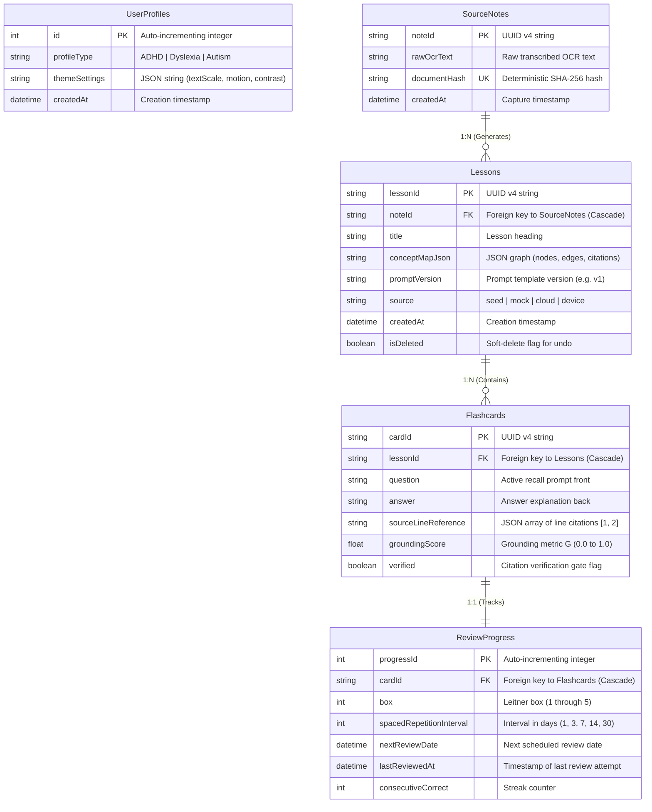

# Relational Data Model & Encrypted Schema

This document details the on-device relational database schema implemented via [Drift ORM](https://drift.simonbinder.eu/) over an encrypted SQLite database using `sqlite3mc` (SQLite3MultipleCiphers 3.9.1 in SQLCipher-compatible AES-256 mode).

---

## 1. Entity-Relationship (ER) Diagram



---

## 2. Table Specifications & Rationale

### 2.1 `UserProfiles`

* **Architectural Purpose:** Persists the learner's active cognitive profile and accessibility fine-tuning. Separated from academic content so changing a profile instantly alters the UI theme without touching note records.
* **Constraints:** Single active user assumption per local device.

| Column | Type | Constraints | Description |
| :--- | :--- | :--- | :--- |
| `id` | `INTEGER` | `PRIMARY KEY AUTOINCREMENT` | Unique identifier. |
| `profile_type` | `TEXT` | `NOT NULL` | Profile choice: `'ADHD'`, `'Dyslexia'`, or `'Autism'`. |
| `theme_settings` | `TEXT` | `NOT NULL DEFAULT '{}'` | JSON string with settings (font scale, contrast toggle, reduced motion). |
| `created_at` | `DATETIME` | `NOT NULL DEFAULT CURRENT_TIMESTAMP` | Profile creation timestamp. |

---

### 2.2 `SourceNotes`

* **Architectural Purpose:** Stores raw, unedited note transcripts with their deterministic SHA-256 hashes. Enables instant on-device duplicate detection: if a student scans identical notes, the app detects the matching hash and navigates directly to the existing study unit without duplicate cloud calls.
* **Constraints:** `document_hash` is marked `UNIQUE`.

| Column | Type | Constraints | Description |
| :--- | :--- | :--- | :--- |
| `note_id` | `TEXT` | `PRIMARY KEY` | Unique UUID v4 string identifier. |
| `raw_ocr_text` | `TEXT` | `NOT NULL` | Complete transcribed text preserving raw formatting. |
| `document_hash` | `TEXT` | `NOT NULL UNIQUE` | SHA-256 hash of whitespace-normalized lowercase text. |
| `created_at` | `DATETIME` | `NOT NULL DEFAULT CURRENT_TIMESTAMP` | Acquisition timestamp. |

---

### 2.3 `Lessons`

* **Architectural Purpose:** Represents a synthesized study unit. Holds the hierarchical title, visual concept map graph JSON, and compilation metadata.
* **Referential Integrity:** References `SourceNotes.note_id` with `ON DELETE CASCADE`. If a source note is permanently purged, child lessons are deleted automatically.
* **Soft Deletion:** Includes `is_deleted` boolean to support immediate undo and recovery via the "Recently Deleted" trash bin before hard deletion.

| Column | Type | Constraints | Description |
| :--- | :--- | :--- | :--- |
| `lesson_id` | `TEXT` | `PRIMARY KEY` | Unique UUID v4 string identifier. |
| `note_id` | `TEXT` | `NOT NULL REFERENCES source_notes(note_id) ON DELETE CASCADE` | Parent source note reference. |
| `title` | `TEXT` | `NOT NULL` | Study unit title (e.g., *Photosynthesis Fundamentals*). |
| `concept_map_json` | `TEXT` | `NOT NULL` | JSON graph containing nodes, edges, labels, and citations. |
| `prompt_version` | `TEXT` | `NOT NULL DEFAULT 'v1'` | Version identifier of compilation prompt. |
| `source` | `TEXT` | `NOT NULL DEFAULT 'seed'` | Generation origin: `'seed'`, `'mock'`, `'cloud'`, or `'device'`. |
| `created_at` | `DATETIME` | `NOT NULL DEFAULT CURRENT_TIMESTAMP` | Generation timestamp. |
| `is_deleted` | `BOOLEAN` | `NOT NULL DEFAULT FALSE` | Soft delete flag for trash management and user recovery. |

---

### 2.4 `Flashcards`

* **Architectural Purpose:** Stores active-recall question/answer pairs generated from the source note. Each card explicitly preserves 1-based line number references (`source_line_reference`), enabling the student to tap "Source Lines" and view the exact note segment that validates the answer.
* **Referential Integrity:** References `Lessons.lesson_id` with `ON DELETE CASCADE`.

| Column | Type | Constraints | Description |
| :--- | :--- | :--- | :--- |
| `card_id` | `TEXT` | `PRIMARY KEY` | Unique UUID v4 string identifier. |
| `lesson_id` | `TEXT` | `NOT NULL REFERENCES lessons(lesson_id) ON DELETE CASCADE` | Parent lesson reference. |
| `question` | `TEXT` | `NOT NULL` | Active recall question displayed on card front. |
| `answer` | `TEXT` | `NOT NULL` | Factual explanation revealed on card flip. |
| `source_line_reference` | `TEXT` | `NOT NULL` | JSON array of 1-based source OCR line numbers (e.g. `"[1, 3]"`). |
| `grounding_score` | `REAL` | `NULLABLE` | Verified lexical grounding score $G \in [0.0, 1.0]$. |
| `verified` | `BOOLEAN` | `NOT NULL DEFAULT FALSE` | Flag indicating passing citation verification. |

---

### 2.5 `ReviewProgress`

* **Architectural Purpose:** Implements the Leitner 5-box spaced repetition scheduling algorithm. Maintains individual card mastery levels, interval calculations, and next scheduled review timestamps.
* **Referential Integrity:** References `Flashcards.card_id` with `ON DELETE CASCADE`.

| Column | Type | Constraints | Description |
| :--- | :--- | :--- | :--- |
| `progress_id` | `INTEGER` | `PRIMARY KEY AUTOINCREMENT` | Unique identifier. |
| `card_id` | `TEXT` | `NOT NULL REFERENCES flashcards(card_id) ON DELETE CASCADE` | Associated flashcard reference. |
| `box` | `INTEGER` | `NOT NULL DEFAULT 1` | Current Leitner Box (1 through 5). |
| `spaced_repetition_interval` | `INTEGER` | `NOT NULL DEFAULT 1` | Current review interval in days (1, 3, 7, 14, 30). |
| `next_review_date` | `DATETIME` | `NOT NULL` | Timestamp when the card becomes due for review. |
| `last_reviewed_at` | `DATETIME` | `NULLABLE` | Timestamp of the most recent review attempt. |
| `consecutive_correct` | `INTEGER` | `NOT NULL DEFAULT 0` | Current streak of consecutive correct answers. |

---

## 3. Cryptographic Storage & Verification

1. **SQLCipher AES-256 Compatibility:**
   * SQLite3MultipleCiphers is opened using the SQLCipher compatibility cipher:

     ```sql
     PRAGMA cipher = 'sqlcipher';
     PRAGMA key = 'base64-key-from-keystore';
     ```

2. **Fail-Closed Verification:**
   * On initialization, `connection_native.dart` executes `PRAGMA cipher;` and queries `sqlite_master`. If cipher activation fails, an exception is thrown, preventing any plaintext database creation.
3. **Automated Cryptographic Evidence:**
   * `test/encryption_verification_test.dart` verifies:
     * The first 16 bytes of the physical SQLite database file do **NOT** equal `"SQLite format 3\0"`.
     * Attempting to open the file with an invalid key throws a cryptographic error and fails closed.
   * `test/cascade_delete_test.dart` verifies referential integrity and cascade deletion down the entire tree.
