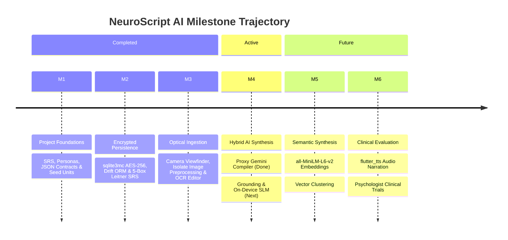

# NeuroScript AI Milestone Execution Roadmap

This document outlines the six-milestone project lifecycle (M1 through M6), detailing verified deliverables, current status, demonstration statements, and remaining work items.

---

## Roadmap Overview

---

## M1: Foundations & Core Data Contracts

* **Target Window:** Month 1
* **Status:** **Completed**
* **Goals:**
  * Define comprehensive System Requirements Specification (`docs/requirements.md`) covering FR-01 through FR-15 and NFR-01 through NFR-08.
  * Establish evidence-based neurodivergent personas for ADHD, Dyslexia, and Autism (`docs/personas.md`).
  * Author and freeze universal lesson schema (`docs/contracts/lesson.schema.json`) and OpenAPI 3.0 specification (`docs/contracts/proxy-api.openapi.yaml`).
  * Curate three author-written academic seed units under `assets/seed/`.
* **Demonstration Statement:**
  * *"The repository contains frozen JSON contracts, schema validation unit tests, and three complete seed units across distinct academic subjects."*
* **Verification Evidence:**
  * `test/seed_contract_test.dart` passes contract validation.

---

## M2: Encrypted Persistence & Spaced Repetition

* **Target Window:** Month 2
* **Status:** **Completed**
* **Goals:**
  * Implement local relational database with Drift ORM over `sqlite3mc` (SQLite3MultipleCiphers 3.9.1).
  * Enforce SQLCipher-compatible mode (`PRAGMA cipher = 'sqlcipher'`) with fail-closed cryptographic verification.
  * Store 256-bit AES database key securely in Android KeyStore / iOS Keychain via `FlutterSecureStorage`.
  * Implement deterministic 5-box Leitner spaced repetition scheduler (`lib/services/scheduler_service.dart`).
  * Implement 2D interactive canvas concept map with pinch-to-zoom gestures.
* **Demonstration Statement:**
  * *"The app launches with hardware-backed encryption, loads seed study sets, schedules card reviews with a 5-box Leitner algorithm, and visualizes concepts on a 2D interactive canvas."*
* **Verification Evidence:**
  * `test/encryption_verification_test.dart` (asserts DB file header is not plaintext and wrong keys fail).
  * `test/cascade_delete_test.dart` (asserts referential integrity and cascading deletes).

---

## M3: Optical Capture, Preprocessing & Transcription Editor

* **Target Window:** Month 3
* **Status:** **Completed**
* **Goals:**
  * Implement camera viewfinder with rectangular framing guide and multi-page capture counter (up to 5 pages).
  * Implement gallery image picker for importing existing lecture photos.
  * Build pure-Dart background isolate image preprocessor (`lib/services/image_preprocessor.dart`) performing bounded resizing, continuous grayscale conversion, CLAHE contrast boost, Gaussian spatial smoothing, and projection variance deskew.
  * Integrate Google ML Kit Text Recognition (`google_mlkit_text_recognition`) with deterministic 1-based line numbering (`L1`, `L2`, ...).
  * Implement full-screen OCR review editor permitting inline typo corrections, line merging, insertion, and deletion.
  * Implement SHA-256 document hashing to prevent duplicate lesson compilation.
* **Demonstration Statement:**
  * *"The student can photograph up to 5 handwritten pages or import photos from the gallery, watch them preprocess in a background isolate, inspect transcribed text with 1-based line provenance, edit typos, and confirm the transcript."*
* **Verification Evidence:**
  * `test/phase3_widget_test.dart` (18 widget tests verifying capture, gallery, and editor).
  * `test/document_hash_test.dart` (hashing and deduplication tests).
  * Real emulator screenshots captured in `docs/images/`.

---

## M4: Hybrid AI Synthesis & Grounding Verification

* **Target Window:** Month 4
* **Status:** **In Progress (M4A Implemented; M4B & M4C Planned)**
* **Sub-Milestone Breakdown:**
  * **M4A — ASP.NET Core Proxy Gateway & Gemini Compiler (Completed):**
    * .NET 10 LTS proxy service (`server/NeuroScriptProxy/`) with sliding-window rate limiter (20 req/min).
    * Constant-time `X-Api-Key` verification, sanitized problem details, and stateless metadata audit logging.
    * Gemini lesson compiler calling Google Gemini API in a closed-book manner.
  * **M4B — Deterministic Grounding Verification Engine (Planned):**
    * Mathematical citation verification ($G \ge 0.80$) checking that every card answer is factually grounded in cited source note lines.
  * **M4C — On-Device SLM Offline Fallback (Planned):**
    * Local quantized language model execution via `llamadart` running GGUF models on-device without cloud dependency.
* **Demonstration Statement (Today):**
  * *"Confirmed note lines are submitted to the ASP.NET Core proxy over HTTPS; the proxy rate-limits requests, validates keys, prompts Gemini, and returns structured lesson JSON validating against the schema."*
* **What Remains:**
  * Land M4B on-device lexical grounding engine in `lib/services/grounding_validator.dart`.
  * Benchmark local GGUF execution on Android NDK via `llamadart` (`docs/TECH_STACK.md`).

---

## M5: Semantic Embeddings & Cross-Note Synthesis

* **Target Window:** Month 5
* **Status:** **Planned**
* **Goals:**
  * Integrate on-device sentence embedding model (`all-MiniLM-L6-v2` via ONNX or TFLite).
  * Generate 384-dimensional dense vectors for individual study units.
  * Perform cosine similarity clustering to link related lecture notes across semesters.
  * Build cross-note concept navigation allowing learners to trace ideas spanning multiple lectures.
* **What Remains:**
  * Implement on-device vector inference pipeline.
  * Add vector distance queries to Drift database.

---

## M6: Assistive Audio (TTS) & Evaluation

* **Target Window:** Month 6
* **Status:** **Planned**
* **Goals:**
  * Integrate Text-to-Speech (TTS) via `flutter_tts` for dyslexia auditory narration with adjustable speech rate.
  * Administer formal usability evaluation with licensed educational psychologists using the drafted instruments in `docs/evaluation/`.
  * Conduct semi-structured qualitative interviews with neurodivergent student participants.
  * Publish final clinical review findings in `docs/EXPERT_REVIEW.md`.
* **What Remains:**
  * Implement `flutter_tts` audio playback service and UI controls.
  * Conduct psychologist evaluations and record feedback.
