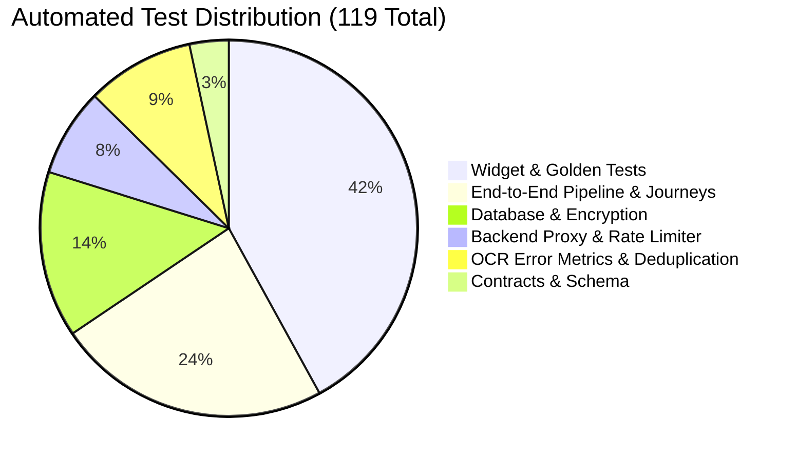

# Automated Testing Strategy & Verification Report

This document details the test suites, verification methodologies, automated test counts, and reproduction commands for NeuroScript AI.

---

## 1. Zero Hallucination Testing Policy

All test counts, assertion thresholds, and verification metrics documented here originate directly from executable code and automated CI test runs.

* Total Passing Flutter Tests: **110 tests**
* Total Passing Backend Proxy Tests: **9 tests**
* Physical hardware execution and clinical trials are marked **NOT TESTED YET** until empirical logs are collected.

---

## 2. Test Catalog & Scope



### 2.1 Mobile Application Suites (`test/`)

| Test File | Test Category | Passing Tests | Primary Capabilities Verified |
| :--- | :--- | :--- | :--- |
| `encryption_verification_test.dart` | Cryptography & Security | 5 | Verifies database magic header is not `"SQLite format 3\0"`; verifies fail-closed rejection on invalid key; verifies 256-bit key storage in hardware keystore. |
| `cascade_delete_test.dart` | Database & Integrity | 5 | Verifies SQLite `PRAGMA foreign_keys = ON`; asserts deleting a `SourceNote` cascades down through `Lessons`, `Flashcards`, and `ReviewProgress`. |
| `document_hash_test.dart` | Algorithm & Deduplication | 4 | Verifies deterministic SHA-256 document hashing with whitespace and case normalization to detect duplicate scans. |
| `migration_test.dart` | Database Schema | 3 | Verifies schema upgrades, column additions, and data preservation across Drift migrations. |
| `seed_contract_test.dart` | Data Contracts | 3 | Asserts that all bundled seed JSON units validate strictly against `docs/contracts/lesson.schema.json`. |
| `theme_wcag_test.dart` | Accessibility Standards | 5 | Evaluates W3C Relative Luminance formula; asserts $\ge 4.5:1$ contrast for text and $\ge 3.0:1$ for UI elements across ADHD, Dyslexia, and Autism profiles. |
| `golden_test.dart` | UI Layout & Scaling | 18 | Renders all primary screens at $1.0\times$ and $2.0\times$ text scale factors; asserts zero `RenderFlex` overflow errors. |
| `ocr_benchmark_test.dart` | Transcription Metrics | 7 | Unit tests Levenshtein-based Character Error Rate (CER) and Word Error Rate (WER) mathematical calculation functions. |
| `phase3_widget_test.dart` | Widget Interaction | 18 | Tests viewfinder framing guides, multi-page page counters, gallery picker triggers, and line-editing actions. |
| `journey_test.dart` & `m3_complete_pipeline_test.dart` | End-to-End Journeys | 28 | Simulates complete flows: onboarding $\to$ profile choice $\to$ OCR line review $\to$ lesson compilation $\to$ Leitner review advancement. |
| `widget_test.dart` | Presentation Layer | 14 | Verifies individual screens (Splash, Library, Concept Map, Flashcard Review, Settings) render correctly with expected widgets. |
| **Subtotal** | | **110** | **All 110 Flutter tests passing** |

---

### 2.2 Backend Proxy Test Suite (`server/NeuroScriptProxy.Tests/`)

| Test File | Test Category | Passing Tests | Primary Capabilities Verified |
| :--- | :--- | :--- | :--- |
| `RateLimiterTests.cs` | Rate Limiting | 4 | Tests sliding-window token bucket enforcement; verifies allowance up to limit, rejection on excess, and reset after 60 seconds. |
| `ProxyEndpointTests.cs` | REST API Integration | 5 | Tests `GET /health`; verifies `X-Api-Key` constant-time verification; tests 401 unauthorized rejection; verifies 413 rejection when line count exceeds 200 lines. |
| **Subtotal** | | **9** | **All 9 xUnit tests passing** |

---

## 3. What is NOT Tested Yet

In strict accordance with the project's zero-hallucination rules:

1. **Physical Handset Hardware Verification:**
   * Automated tests currently execute in headless Android emulators and Linux CI runners. Physical testing on specific retail Android and iOS handsets is tracked as **NOT TESTED YET** in [docs/DEVICE_VERIFICATION_MATRIX.md](DEVICE_VERIFICATION_MATRIX.md).
2. **Real-World Handwriting CER/WER Benchmarks:**
   * CER/WER calculation math is verified in unit tests, but large-scale empirical OCR benchmarks on physical student handwriting across varied penmanship styles are **NOT MEASURED YET**.
3. **Clinical Efficacy Trials:**
   * Neurodivergent usability feedback is undergoing formal review by licensed educational psychologists; clinical results are **NOT MEASURED YET** ([docs/EXPERT_REVIEW.md](EXPERT_REVIEW.md)).

---

## 4. How to Reproduce All Test Results

### 4.1 Reproduce Flutter Suite

```bash
# Ensure dependencies and generated code are current
flutter pub get
dart run build_runner build --delete-conflicting-outputs

# Execute all tests with full reporting
flutter test
```

Expected output:

```text
00:13 +110: All tests passed!
```

### 4.2 Reproduce Backend Proxy Suite

```bash
# Run xUnit test project
dotnet test server/NeuroScriptProxy/NeuroScriptProxy.sln
```

Expected output:

```text
Passed!  - Failed: 0, Passed: 9, Skipped: 0, Total: 9
```
